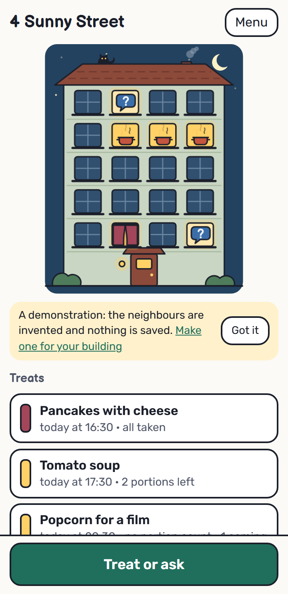

# Neighbor food

Treat the people in your building to something home-made, or ask for it. A poster with a QR code
hangs in the entrance; whoever scans it sees a drawn house whose windows light up with "soup at
three, three portions", "popcorn tonight", "who bakes bread this week?". Neighbours agree on where
to meet themselves. Gifts and requests only: no money, no prices.

Nothing to install, no registration, Polish, Russian and English.

## Try the demo

**<https://exgeni.github.io/neighbor-food/>** (the neighbours there are invented and nothing is
saved).




A demonstration poster with this QR: [`#/demo/poster`](https://exgeni.github.io/neighbor-food/#/demo/poster).

## Run it on your computer

Needs [Node](https://nodejs.org) 22.12 or newer (the project uses 24, see `.nvmrc`).

```sh
npm ci
npm run dev          # the demonstration
```

The whole app, with a local copy of the database, also needs Java 21 or newer:

```sh
npm run dev:emulator # prints a test organiser code; open the printed address plus #/new
```

Checks:

```sh
npm test             # logic, translations, the build's config check
npm run test:rules   # database rules and the database client, on the local emulators
npx playwright install chromium   # once
npm run test:e2e     # two phones in a real browser, on the local emulators
```

## Host your own entrance

This is for people comfortable with GitHub. It has not yet been verified by a second person. Your
entrance lives in **your own** free Firebase project; nobody else's server holds your neighbours'
posts, and you are the one responsible for them.

1. **Fork** this repository on GitHub. In the fork open the *Actions* tab and enable workflows.
2. In the fork: *Settings → Pages → Build and deployment → Source:* **GitHub Actions**. Your site
   will be `https://<your name>.github.io/neighbor-food/`.
3. In the [Firebase console](https://console.firebase.google.com): *Add project*. Analytics is not
   needed. Stay on the free **Spark** plan; no card is asked.
4. *Build → Firestore Database → Create database*. Pick a region near you (for example
   `europe-central2`, Warsaw) and **production mode** (everything refused until step 10).
5. *Build → Authentication → Get started → Sign-in method → Anonymous → Enable.*
6. Back in Firestore, *Start collection*: collection id `config`, document id `owner`, one field
   `code` of type **string**. This is your organiser code, at least 16 characters; make one with
   `node -e "console.log(require('crypto').randomBytes(18).toString('base64url'))"`.
   Keep it to yourself: it is what lets someone create entrances in your project.
7. *Project settings → General → Your apps →* the `</>` (web) button. Register the app (no
   hosting). The console shows `const firebaseConfig = {...}`. Rewrite it as JSON, with quoted
   keys, on the model below. These values are public by design.
   ```json
   {"apiKey":"…","authDomain":"…","projectId":"…","storageBucket":"…","messagingSenderId":"…","appId":"…"}
   ```
8. In the fork: *Settings → Secrets and variables → Actions → **Variables** tab → New repository
   variable*: name `FIREBASE_CONFIG`, value the JSON from step 7.
9. *Actions → Test and publish → Run workflow* (branch `main`). Open the log of the **build** job:
   it must say `database: configured (<your project>)`. (The `test` job always says
   `database: none`; that is expected.)
10. In the console, *Firestore Database → Rules*: replace everything with the contents of
    [`firestore.rules`](firestore.rules) and press **Publish**. (With the Firebase CLI:
    `npx firebase deploy --only firestore:rules --project <your project>`.)
11. Limit the browser key: [Google Cloud console](https://console.cloud.google.com/apis/credentials)
    → your project → the key named *Browser key*. Application restrictions: *Websites*, add
    `https://<your name>.github.io/*`. API restrictions: *Identity Toolkit API*, *Token Service
    API*, *Cloud Firestore API*.
12. Open `https://<your name>.github.io/neighbor-food/#/new`, type the organiser code, the entrance
    name, the number of floors and how neighbours can reach you. You get the poster.
13. **Check that it works:** scan the poster with a phone, enter, post something; take it with a
    second phone. Or from your computer: install [Node](https://nodejs.org), clone your fork, run
    `npm ci` and `npx playwright install chromium`, put the config into `.env.local` as
    `VITE_FIREBASE_CONFIG='{…}'`, then:
    ```sh
    npm run check:live -- https://<your name>.github.io/neighbor-food/ <entrance key>
    ```
    The entrance key is the part of the address after `#/e/`. Use a test entrance, or do this
    before the poster is up: the check posts a test offer and removes it.

| Mode | What decides it |
|---|---|
| demonstration only | no `FIREBASE_CONFIG` / `VITE_FIREBASE_CONFIG` |
| your database | the repository variable `FIREBASE_CONFIG`, or `VITE_FIREBASE_CONFIG` in `.env.local` |
| local emulators | `VITE_FIREBASE_EMULATOR=1` (wins over both) |

Another address path? Set `BASE_PATH` (the workflow takes it from the repository name).

## Organise and moderate

- **Before hanging the poster:** ask permission to hang it, and post the first offer, so the first
  visitor does not find an empty house.
- **The poster again:** open `…/#/e/<entrance key>/poster`.
- **Change the name or contact:** edit the document `entrances/<key>` in the console.
- **Remove a post:** delete it under `entrances/<key>/posts`.
- **Close an entrance:** set `closed` (type boolean) to `true`. The link then shows "does not work
  any more". To remove the data, delete the document with its subcollections.
- **Anonymous accounts** pile up under *Authentication → Users*; delete them there.
- **A leaked link or QR:** create a new entrance, hang the new poster, close the old one. A page
  already open somewhere may keep showing posts until it is reloaded; delete the old posts too.
- **After a trial:** either keep it running, or close the entrance and clear its data.

- **Watch once** whether a neighbour finds an offer through the chat and finds the meeting place.

### Updating your fork

1. Read the [changelog](CHANGELOG.md): did the rules change?
2. *Sync fork* on GitHub.
3. If they did, publish the new `firestore.rules` **before** the new site goes live (cancel the run
   the sync started, publish, then run the workflow again).
4. Run `npm run check:live` as in step 13.

To go back: *Actions →* the last good run *→ Re-run all jobs* brings back that site; if the rules
changed too, publish the previous `firestore.rules` from that commit (the console also keeps the
history of published rules).

## Troubleshooting

The page shows a code with every problem.

### NF-BUILD-CONFIG-JSON

The build stopped: `FIREBASE_CONFIG` is not one JSON object. Quote every key, no `const`, no
trailing comma or semicolon (see step 7).

### NF-BUILD-CONFIG-FIELD

The build stopped: a field of the web app config is missing, or there is a field that does not
belong to it.

### NF-BUILD-CONFIG-SECRET

The build stopped: this looks like a **server** key. It must never be published. The run log may
already show it, so: revoke (delete) that key in the console, delete the workflow run on GitHub,
and put the web app config of step 7 into the variable.

### NF-AUTH-OFF

Anonymous sign-in is not enabled (step 5).

### NF-AUTH-LIMIT

Too many sign-ins from one network in a short time. Wait and try again.

### NF-KEY-BLOCKED

The browser key does not allow this site or one of the three APIs (step 11).

### NF-NEW-REFUSED

The entrance was not created. Check in this order: the rules are published (step 10);
`config/owner` has a **string** field `code` of 16 characters or more (step 6); the code you typed
is the same.

### NF-NEW-UNCONFIRMED

No answer came back. Keep the page and press *Create* again: it first checks whether the entrance
already exists.

### NF-ENTRY-DENIED

The database refused. Reload once. If it stays: the entrance may be closed or replaced (look for a
new poster), the rules may not be published, or the phone's clock is wrong.

### NF-LIVE-STOPPED

Live updates stopped. Press *Try again*.

### NF-NET-UNCONFIRMED

The service did not answer. Check the network.

### NF-QUOTA

The free daily quota of the project is used up. It comes back at the daily reset; a new entrance
does not help.

### NF-EMU-DOWN

Local development only: start the emulators with `npm run dev:emulator`.

### NF-UNEXPECTED

Anything else. Check whether your last action went through before repeating it, then reload. The
browser console has a line starting `[neighbor-food]`.

## Risks you accept

The only protection is the entrance link and the database rules. Anyone who has the link can post
without limit, take every portion from several browsers, pose under another name, or use up the
free daily quota. Sharing an offer into a chat puts the entrance key into that chat. All pages of
one `github.io` account share browser storage, so a script on any of them could read the entrance
key and the sign-in: do not put third-party scripts on your other pages. Restricting the browser
key limits casual reuse only. The answer to abuse is to close the entrance and make a new one.

Home-made food is eaten at one's own risk; the page says so and asks to mention allergens.

## Filming

Do not show a real entrance's QR or address in a video: anyone who sees it can enter. For shots of
the poster use [`#/demo/poster`](https://exgeni.github.io/neighbor-food/#/demo/poster). For shots of
people using it, create a second, disposable entrance with invented names and contact, film with
the consent of those filmed, and close that entrance before publishing the video. In the video,
point viewers to the demo.

## How it is built

Vite and TypeScript without a UI framework; the drawing and all motion are SVG and CSS. Firebase
anonymous sign-in and Firestore, with [the rules](firestore.rules) as the protection. The demo and
the tests use an in-memory store that passes the same suite as the real client.
[Requirements](docs/designs/neighbor-food-living-house.md) · [Design](DESIGN.md) ·
[Later ideas](TODOS.md)

Fonts: Rubik and Balsamiq Sans (SIL Open Font License), served from the site itself.

Open source under the [MIT license](LICENSE).
